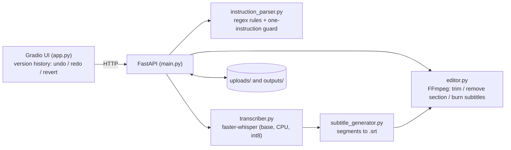

# Prompt-Based Video Editing Engine

Upload a video, type **one plain-English instruction**, and get the edited
video back. Every edit is kept as a version, so it can be undone, redone or
reverted.

| Say | What happens |
|---|---|
| `Trim the video from 5 seconds to 15 seconds` | keeps only 5s to 15s |
| `Remove from 10 seconds to 12 seconds` | deletes that range and joins the rest |
| `Remove the first 2 seconds` | deletes the start |
| `Add subtitles to the video` | transcribes speech and burns subtitles into the video |

Only one edit per message. Messages that chain edits ("trim ... and then add
subtitles") are rejected with a message asking for one at a time.

## Architecture



| File | Role |
|---|---|
| `app.py` | Gradio web UI and the version history (undo/redo/revert) |
| `main.py` | FastAPI server: upload, edit-by-instruction, downloads |
| `instruction_parser.py` | turns one sentence into an edit plan; rejects multi-instruction messages |
| `editor.py` | FFmpeg wrappers: `trim_video`, `remove_section`, `burn_subtitles` |
| `transcriber.py` | speech-to-text with faster-whisper |
| `subtitle_generator.py` | writes the `.srt` file |

**How versions work.** The API always edits an uploaded file. After each
successful edit the UI downloads the result and uploads it again as a new
video, so the next edit builds on it. Undo, redo and "jump to version" only
move a pointer in the UI, so they are instant. History lives in the browser
session and is lost on page refresh.

## Setup

Requires Python 3.10+ and **FFmpeg with ffprobe** on your PATH.

```bash
python -m venv .venv
source .venv/bin/activate            # Windows: .venv\Scripts\activate
pip install fastapi uvicorn python-multipart pydantic requests gradio faster-whisper
uvicorn main:app --port 8000         # terminal 1: API
python app.py                        # terminal 2: UI at http://127.0.0.1:7860
```

`transcriber.py` loads the Whisper `base` model when the API starts, so the
first start downloads about 150 MB and takes longer.

## Tests and batch runner

**This version has neither.** There is no automated test suite and no batch
runner. Manual check: start both servers, upload a short clip, and try the
four example instructions in the table above.

Quick API check without the UI:

```bash
curl -F "file=@clip.mp4" http://127.0.0.1:8000/upload
curl -X POST http://127.0.0.1:8000/edit-by-instruction \
  -H "Content-Type: application/json" \
  -d '{"video_id": "<id from upload>", "instruction": "Trim the video from 1 second to 3 seconds"}'
```

## Settings

There is no config file or environment variable support; settings are
constants in the code:

| Setting | Where | Value |
|---|---|---|
| API address used by the UI | `app.py` `API_BASE_URL` | `http://127.0.0.1:8000` |
| UI address | `app.py` bottom | `127.0.0.1:7860` |
| Upload / output folders | `main.py` | `uploads/`, `outputs/` |
| Max upload size | `main.py` `MAX_FILE_SIZE` | 500 MB |
| Allowed formats | `main.py` `ALLOWED_EXTENSIONS` | mp4, mov, mkv, webm |
| Whisper model | `transcriber.py` | `base`, CPU, int8 |
| Trim / remove encode | `editor.py` | H.264, preset `medium`, CRF 18, AAC, 600 s timeout |
| Subtitle burn encode | `editor.py` | H.264, preset `fast`, CRF 20, audio copied, no timeout |

## API

`POST /upload`, `POST /edit-by-instruction`, `POST /videos/{id}/subtitles`,
`POST /trim`, `GET /videos/{id}/metadata`, `GET /outputs/{file}`,
`GET /health`, `GET /` (interactive docs at `/docs`).

## Known limits

See `REPORT.md`. In short: seconds-only phrasing, one edit per message,
every edit is a full re-encode, and `remove_section` can run out of memory on
videos longer than about a minute or two at 720p. `SOURCES.md` lists licences
(including an FFmpeg/x264 note) and `AI_USE.md` lists AI tool use.
